# Instagram clone

A full Instagram-style social network that looks and behaves like the real website: a home feed with stories,
**Reels**, **direct messages**, **reposts**, **music** on posts, reels and stories, double-tap likes, comments,
saves, follows, profiles, Explore, hashtags, search, notifications and a composer with filters.
It goes further than Instagram in a few places too: a chronological feed, filters and music you can change
after posting, keyboard shortcuts, and pages that work without JavaScript.

Node.js, Express, EJS and MySQL, with no frontend framework and no build step.

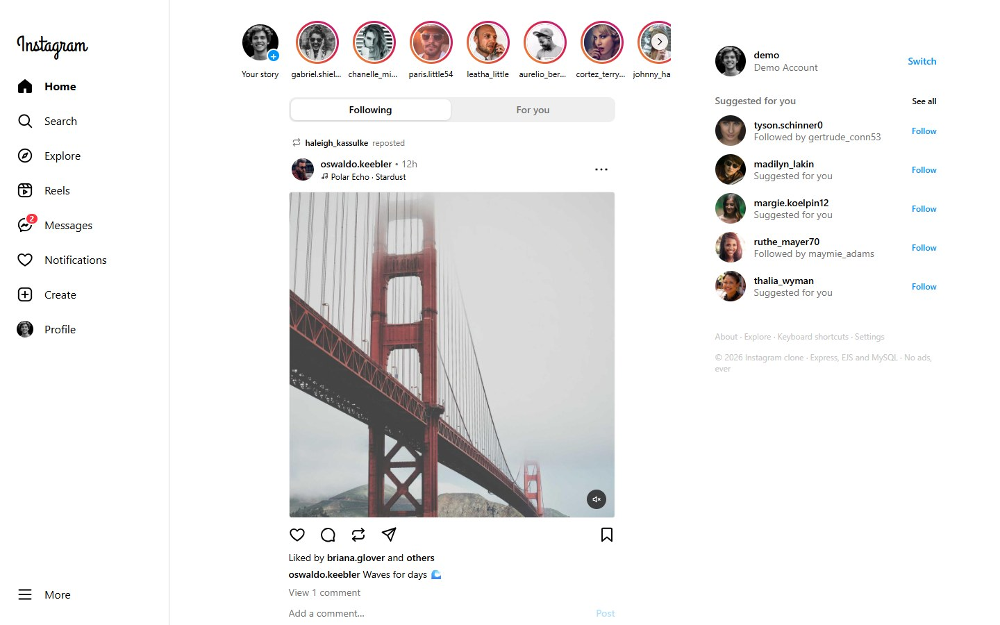

## Contents

- [Quick start (no database)](#quick-start-no-database)
- [Screenshots](#screenshots)
- [Features](#features)
- [Setup with MySQL](#setup-with-mysql)
- [Tests](#tests)
- [Security](#security)
- [How it's built](#how-its-built)

## Quick start (no database)

You need **Node.js 20.19 or newer** ([download](https://nodejs.org)). Check with `node --version`.

```bash
git clone https://github.com/abhay9494/InstagramClone.git
cd InstagramClone
npm install
npm run demo
```

Open **http://localhost:8080** and click **Log in with the demo account**.

Demo mode fills memory with 40 people, 500 photos, 14 reels, about 7,800 likes, 1,900 comments, reposts, stories,
music and a few chats, so everything looks lived-in. Nothing is saved when you stop the server (<kbd>Ctrl</kbd> +
<kbd>C</kbd>). To keep your data, set up MySQL (below).

> Photos and avatars in the demo load from the internet ([Lorem Picsum](https://picsum.photos) and
> [Pravatar](https://pravatar.cc)); the reels and music are included in `public/media`.

## Screenshots

| | |
|---|---|
| 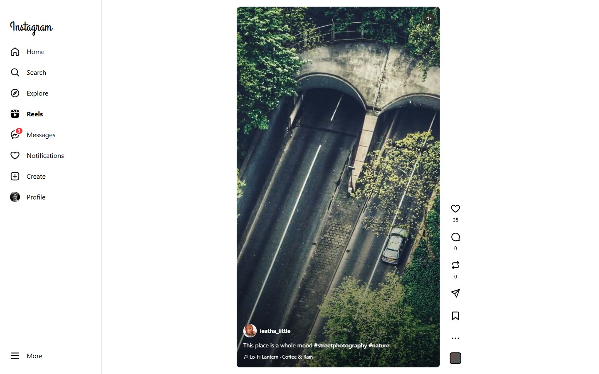 | 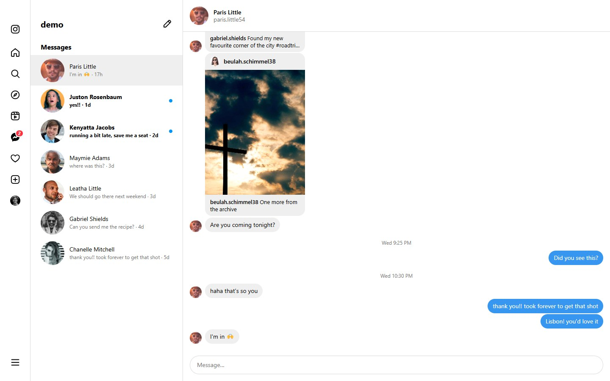 |
| **Reels** — full-height videos that play as you scroll, with music | **Messages** — chats that update live, shared posts, unread badges, "Seen" |
| 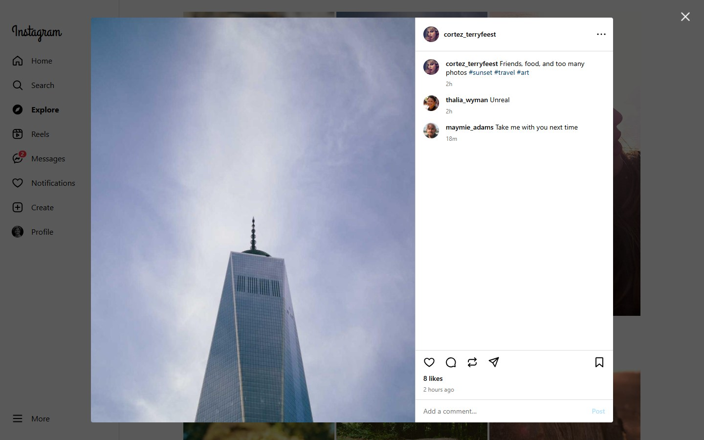 | 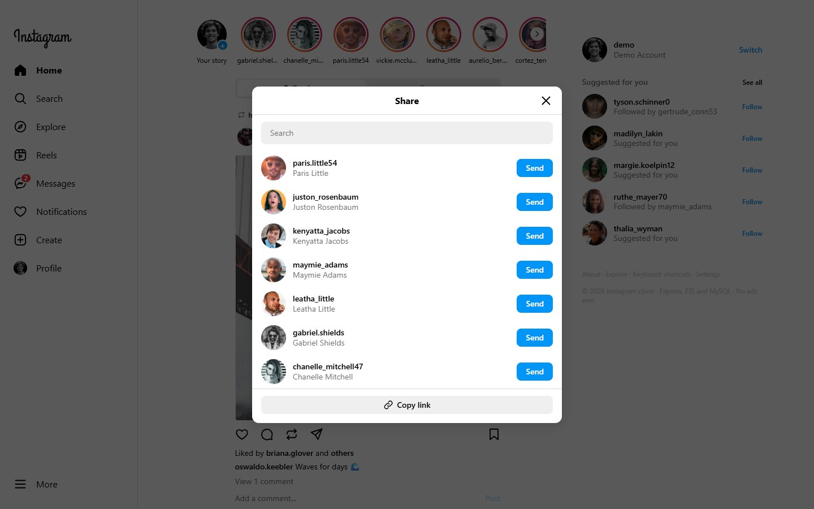 |
| **Post pop-up** — opens over the page with its own address | **Share** — send a post or reel to people in your chats, or copy the link |
| 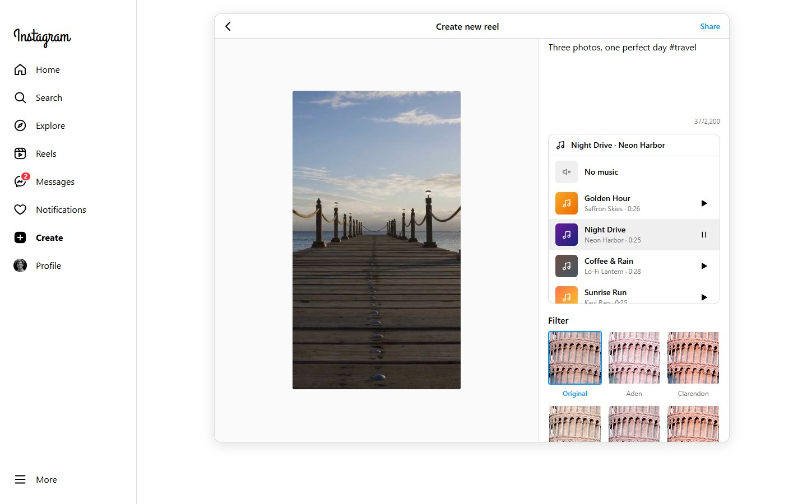 | 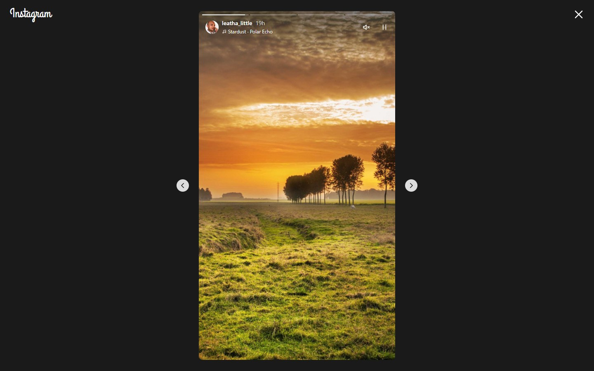 |
| **Create** — photos, reels and stories, 12 filters, 3 shapes, 8 music tracks | **Stories** — with music, progress bars, tap to skip, hold to pause |
| 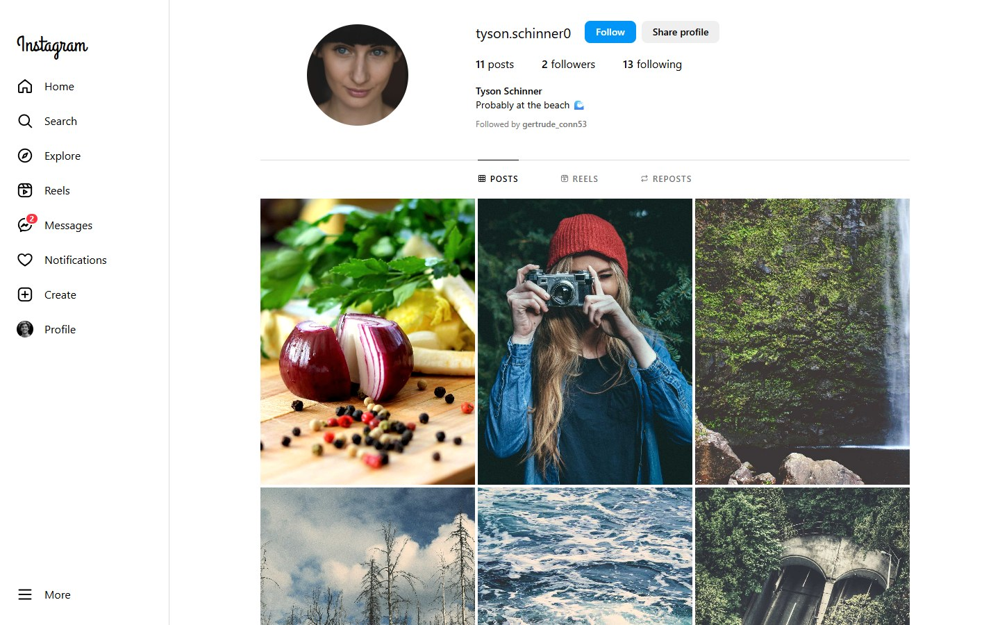 | 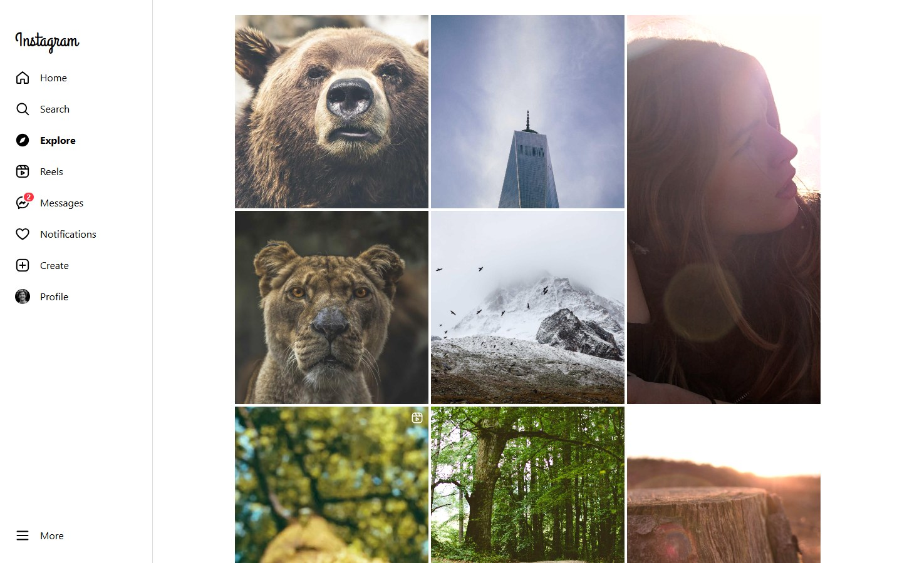 |
| **Profile** — Posts, Reels, Reposts and (your own) Saved tabs | **Explore** — ranked by likes and comments over age |
| 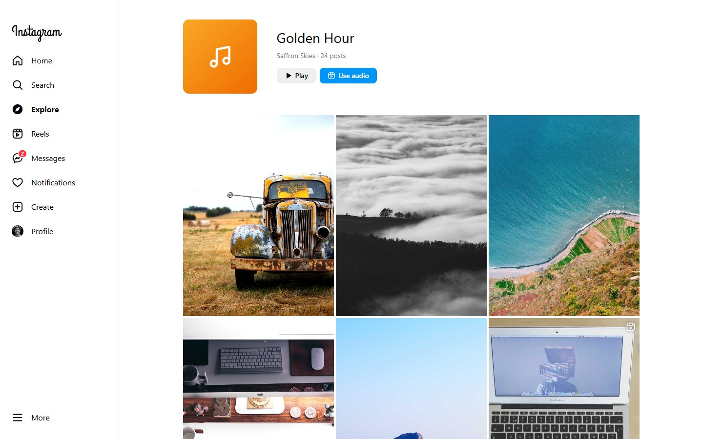 | 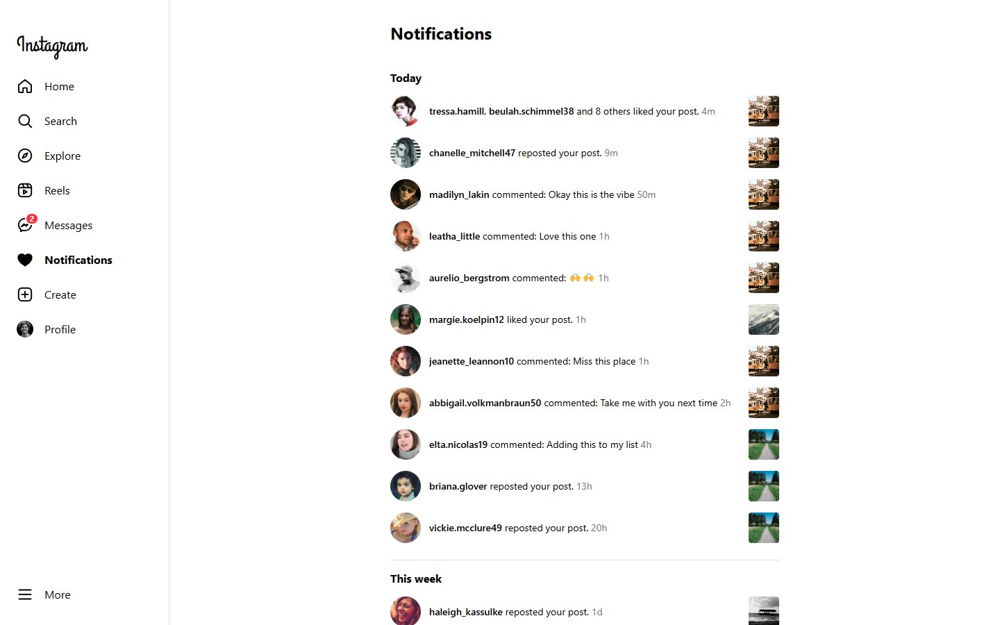 |
| **Audio pages** — every post and reel using a track, with "Use audio" | **Notifications** — likes grouped per post, comments, reposts, new followers |
| 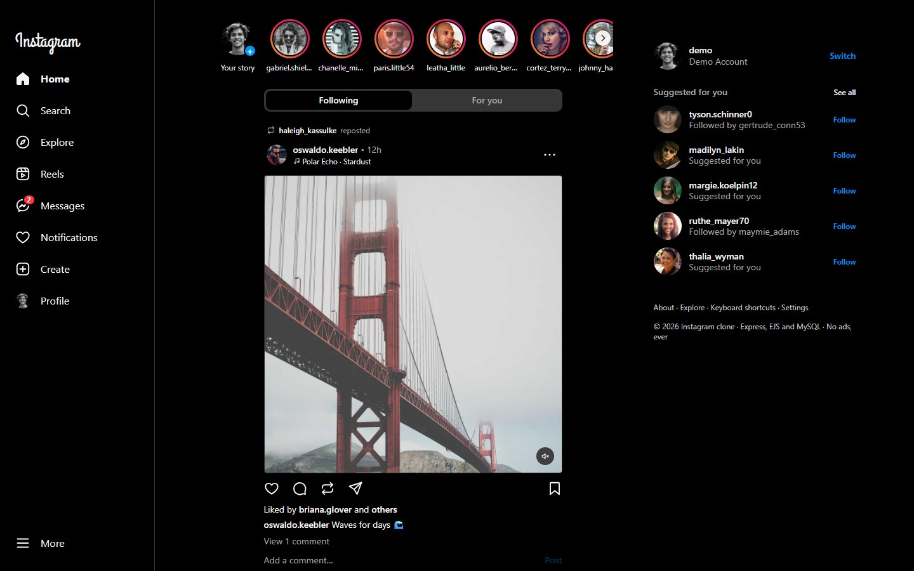 | 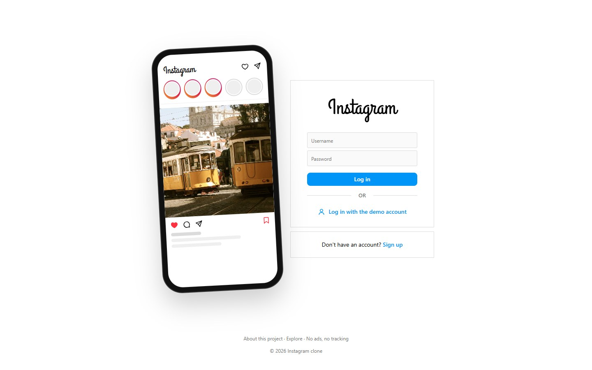 |
| **Dark mode** — follows your system, or switch it yourself | **Log in** — or try the demo account |

**On a phone** — top bar, bottom tab bar, full-screen reels, one-pane chats:

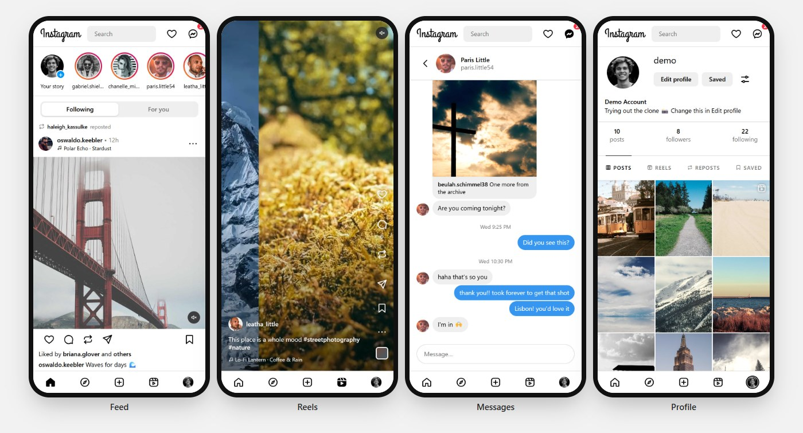

## Features

Everything Instagram's website does:

- **Accounts**: sign up, log in, log out, and edit your name, bio and profile photo.
- **Home feed**: posts and reels from people you follow, newest first, plus what they reposted, loading more as
  you scroll and ending with *You're all caught up*.
- **Reels**: upload a video (MP4, WebM or MOV, up to 50 MB). It plays on the Reels page (scroll or press
  <kbd>j</kbd>/<kbd>k</kbd>), in the feed, on profiles and in Explore. Plays are counted after 2 seconds, and the
  page picks a still from your video as its poster.
- **Messages**: one-to-one chats with an inbox, unread dots and a red badge on the Messages icon. New messages
  and "Seen" arrive instantly without reloading (Server-Sent Events).
- **Reposts**: repost someone's post or reel. It appears in your followers' feeds as "*you* reposted" and on your
  profile's Reposts tab, and the author is notified.
- **Music**: add one of 8 tracks to a post, reel or story. It plays when the post is on screen and sound is on,
  with one sound switch for the whole site. Each track has a page of the posts that use it, with a **Use audio**
  button.
- **Stories**: share a photo story (with music if you like) and watch them in a full-screen player that moves on
  to the next person. Rings turn grey once seen, and stories are gone after 24 hours.
- **Likes and comments**: the heart, or double-tap the photo. Comments support #hashtag and @mention links; you
  can delete your own comments, or any comment on your own post.
- **Saves and sharing**: a private Saved tab, and a share sheet that sends a post to people you chat with or
  follow, or copies the link.
- **Follows**: follow, unfollow, follower and following lists, suggestions, "Followed by a, b + 3 more".
- **Explore, hashtags and search**: a ranked grid, a page per #tag, and live search for people and hashtags.
- **Notifications**: grouped into Today, This week, This month and Earlier.
- **Create**: drag and drop, Post / Reel / Story, 12 filters (Clarendon, Juno, Lark, Moon…),
  square / portrait / landscape, alt text, music. You can edit or delete your posts later.
- **Light and dark themes**, and a responsive layout for desktop, tablet and phone.

### Where it goes further than Instagram

| | Instagram | This clone |
|---|---|---|
| Feed order | Algorithmic | **Following** is newest first; **For you** is the ranked one; you choose |
| Ads and sponsored posts | Yes | **None** |
| Filters, crop and music | Fixed once posted | **Change the filter, shape and music any time**; your original is kept |
| Alt text | Hidden in advanced settings | **Right in the composer**, used everywhere the post appears |
| Keyboard | Barely | <kbd>j</kbd>/<kbd>k</kbd> move, <kbd>l</kbd> like, <kbd>r</kbd> repost, <kbd>s</kbd> save, <kbd>m</kbd> sound, <kbd>c</kbd> comment, <kbd>/</kbd> search, <kbd>g</kbd> <kbd>r</kbd> reels, <kbd>g</kbd> <kbd>d</kbd> messages… (<kbd>?</kbd> lists them all) |
| Without JavaScript | Blank page | **Posting, liking, commenting, following, messaging and browsing still work** (plain links and forms) |
| Run it yourself | — | `npm run demo`, no setup |

**Not included:** group chats, video stories, live video, and message requests (anyone can message anyone).

## Setup with MySQL

Use MySQL when you want accounts, posts and messages to be saved.

**1. Install MySQL 8** if you don't have it:
- Windows: [MySQL Installer](https://dev.mysql.com/downloads/installer/). Choose the server, and remember the root
  password you set. Start the service with `net start MySQL80` (in a terminal opened as administrator).
- macOS: `brew install mysql` then `brew services start mysql`
- Ubuntu/Debian: `sudo apt install mysql-server` then `sudo systemctl start mysql`

**2. Get the code and install the packages** (skip if you did the quick start):

```bash
git clone https://github.com/abhay9494/InstagramClone.git
cd InstagramClone
npm install
```

**3. Create your settings file** from the example:

```bash
cp .env.example .env          # Windows Command Prompt: copy .env.example .env
```

Open `.env` and fill in at least:

```ini
DB_PASSWORD=your-mysql-root-password
SESSION_SECRET=any-long-random-text
```

To make a good `SESSION_SECRET`, run `node -e "console.log(require('crypto').randomBytes(32).toString('hex'))"`.

**4. Add the demo data** (this also creates the database and tables):

```bash
npm run seed
```

**5. Start the app:**

```bash
npm start                     # → http://localhost:8080
```

Log in as **demo** with the password **instaclone**, or sign up for your own account.

All the settings in `.env` (the file is git-ignored, never commit it):

| Variable | Default | |
|---|---|---|
| `DB_HOST`, `DB_PORT` | `localhost`, `3306` | MySQL server |
| `DB_USER`, `DB_PASSWORD` | `root`, — | MySQL login |
| `DB_NAME` | `insta_post` | created if missing |
| `SESSION_SECRET` | random at each start | signs the login cookies; set it so logins survive restarts |
| `IMGUR_CLIENT_ID` | — | upload photos to Imgur ([register an app](https://api.imgur.com/oauth2/addclient)); without it, uploads stay in `public/uploads`. Videos always stay on the server |
| `PORT` | `8080` | |

**Good to know**
- `npm run seed` won't touch a database that already has accounts. `npm run seed -- --reset` deletes the app's
  tables and adds fresh demo data. Stories only last 24 hours, so re-seed to see them again.
- A database made by an earlier version of this app is upgraded automatically when the app starts (new columns
  and tables are added; nothing is deleted).
- **"Could not connect to MySQL"**: check that MySQL is running and that `DB_PASSWORD` in `.env` is right. Or use
  `npm run demo`, which needs no database.
- **Port 8080 is busy**: set `PORT=3000` in `.env`.

## Tests

```bash
npm test
```

The end-to-end tests drive the real app over HTTP with the demo data. They cover sign-up rules, login lockout,
cookie tampering, feed paging, likes, saves, reposts, comments, reels (including fake videos), music, messages
(including live delivery and read receipts over Server-Sent Events), sharing, editing permissions, follows,
stories, search, notifications, HTML escaping, the CSP and CSRF checks, and the SQL placeholders.

The data layer has two implementations (MySQL and in-memory) behind one interface. To prove they behave the same,
one set of checks runs against both and the results are compared, including every query over the full demo data:

```bash
TEST_DB_PORT=3306 TEST_DB_PASSWORD=your-mysql-password npm test   # uses its own database, insta_test
```

That's 46 tests with a test database, all passing on MySQL 8.0. Without one, the MySQL comparison is skipped.

## Security

- **Passwords** are hashed with scrypt and a random salt. A wrong username takes as long to reject as a wrong
  password, and the message never says which one was wrong.
- **Logins** use an HMAC-signed, HttpOnly, SameSite cookie that expires after 30 days. Changing it logs you out.
- **Brute force**: 10 failed logins for a username lock it for 15 minutes.
- **Cross-site requests** (CSRF) are refused by checking each form's Origin.
- **Content Security Policy**: scripts only from this site, no inline scripts, no framing.
- **Uploads** must really be photos or videos (checked by their first bytes). They get a random name and an
  extension chosen by the server, so an upload can never be served as a web page. Deleting a post deletes its files.
- **SQL**: every value is a `?` placeholder, and only known columns can be changed.
- **HTML**: everything people type is escaped; hashtags and mentions are linked after escaping.
- **Permissions**: only the author can edit or delete a post, only you can see your saved posts, and you can't
  message or follow yourself or repost your own posts.

## How it's built

```
index.mjs           starts the server (MySQL, or --demo for in-memory)
app.mjs             routes, sessions, uploads, live messages, security headers
store/mysql.mjs     MySQL tables and queries (and upgrades for older databases)
store/memory.mjs    the same interface in memory (demo mode and tests)
store/shared.mjs    ranking, feed cursors and hashtag rules both stores share
lib/auth.mjs        password hashing, signed cookies, login lockout
lib/text.mjs        captions with links, "3h" times, "12.5K" counts, filters, username rules
lib/music.mjs       the music library
lib/icons.mjs       the interface icons (inline SVG)
images.mjs          Imgur upload, or local storage
seed.mjs            the demo data (Faker, the same every run)
views/              EJS pages and partials
public/             style.css, app.js (progressive enhancement), media/ (demo reels and music), uploads/
test/               end-to-end, unit and store tests
```

### Pages and actions

| Method | Path | |
|---|---|---|
| GET | `/` | Home feed (`?tab=foryou` for the ranked feed) |
| GET | `/reels` | Reels (`?start=<id>` opens one first) |
| GET | `/explore`, `/explore/tags/:tag`, `/audio/:track` | Explore, a hashtag, a music track |
| GET | `/search?q=` | Search people and hashtags |
| GET | `/activity` | Notifications |
| GET, POST | `/create`, `/p` | The composer; share a post, reel or story |
| GET, PATCH, DELETE | `/p/:id`, `/p/:id/edit` | A post or reel; edit; delete |
| POST, DELETE | `/p/:id/like`, `/p/:id/save`, `/p/:id/repost` | Like, save, repost |
| POST | `/p/:id/view` | Count a reel play |
| POST, DELETE | `/p/:id/comments`, `/comments/:id` | Comment, delete a comment |
| GET, POST | `/p/:id/share` | The share sheet; send a post to someone |
| GET, POST | `/direct/inbox`, `/direct/new`, `/direct/t/:username` | Messages: inbox, new chat, a conversation |
| GET | `/direct/events` | Live messages and read receipts (Server-Sent Events) |
| GET, POST | `/stories/:username`, `/stories/:id/seen` | Story player |
| GET | `/:username`, `/:username/reels`, `/:username/reposts`, `/:username/saved`, `/:username/followers`, `/:username/following` | Profile pages |
| POST, DELETE | `/:username/follow` | Follow, unfollow |
| GET, POST | `/login`, `/signup`, `/logout`, `/accounts/edit`, `/appearance` | Accounts and settings |

Likes, saves, reposts, follows, comments and messages answer JSON when asked (`Accept: application/json`) and
redirect back for plain forms. HTML forms send PATCH and DELETE through `?_method=`.

---

A learning project, not affiliated with Instagram or Meta. Sample photos come from [Lorem Picsum](https://picsum.photos)
and avatars from [Pravatar](https://pravatar.cc). The 14 demo reels are short clips made from Lorem Picsum photos,
and the 8 music tracks are original instrumental loops made for this project.
